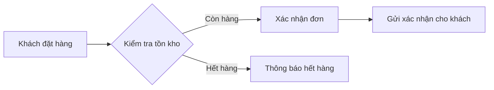

# BRD Template & Section Guide

The full Business Requirements Document template. Each section has a short **purpose** (why it exists) and
a **prompt** (what to write). Output is Vietnamese by default. Fill only the sections the project's size
warrants — see the scaling guidance in SKILL.md. Delete a section entirely rather than leaving it with
placeholder filler.

Requirement IDs and priorities make the doc negotiable: use `BR-01`, `BR-02`, … and a priority of
**Must / Should / Could / Won't** (MoSCoW) or High / Medium / Low. Keep priorities consistent within one doc.

---

## Document template (copy & fill)

```markdown
# BRD — <Tên dự án / sáng kiến>

| | |
|---|---|
| **Phiên bản** | v0.1 (draft) |
| **Ngày** | <YYYY-MM-DD> |
| **Người soạn** | <tên> |
| **Trạng thái** | Draft / In Review / Approved |
| **Nguồn tài liệu** | <liệt kê file/nguồn đã dùng để tổng hợp> |

---

## PHẦN 1 — TÓM TẮT ĐỂ REVIEW

### 1. Tóm tắt điều hành (Executive Summary)
<3–6 câu: vấn đề đang giải quyết, kết quả kỳ vọng, và giá trị kinh doanh. Người bận rộn chỉ đọc phần này.>

### 2. Mục tiêu kinh doanh & Chỉ số thành công
| Mục tiêu | Chỉ số đo lường (KPI) | Hiện tại | Mục tiêu |
|---|---|---|---|
| <VD: Giảm thời gian xử lý đơn> | <thời gian TB/đơn> | <15 phút> | <5 phút> |

> Chỉ điền số khi tài liệu nguồn có căn cứ. Không bịa số — nếu chưa có, đưa vào Câu hỏi mở.

### 3. Phạm vi (Scope)
**✅ Trong phạm vi:**
- <...>

**❌ Ngoài phạm vi:**
- <...>

### 4. Câu hỏi mở (Open Questions)
Những điểm chỉ user/stakeholder mới quyết định được — không được tự giả định.
- **OQ-01:** <câu hỏi> — *cần ai trả lời:* <vai trò>
- **OQ-02:** <...>

### 5. Giả định chính (Key Assumptions)
Những mặc định đã tự chọn để viết tiếp; user có thể override.
- **AS-01:** <giả định> — *căn cứ:* <lý do>

---

## PHẦN 2 — CHI TIẾT

### 6. Bối cảnh & Vấn đề nghiệp vụ (Background & Context)
<Tình hình hiện tại, nỗi đau đang gặp, vì sao làm bây giờ ("why now"). Đây là phần "tại sao" cốt lõi.>

### 7. Các bên liên quan (Stakeholders)
| Bên liên quan | Vai trò | R/A/C/I |
|---|---|---|
| <Sponsor / Business Owner> | <người duyệt cuối> | A |
| <Trưởng nghiệp vụ> | <cung cấp yêu cầu> | R |
| <Người dùng cuối> | <bị ảnh hưởng> | I |

> RACI: **R**esponsible (làm), **A**ccountable (chịu trách nhiệm/duyệt), **C**onsulted (được hỏi ý kiến),
> **I**nformed (được thông báo).

### 8. Yêu cầu nghiệp vụ (Business Requirements)
Phần cốt lõi. Mỗi yêu cầu là một **nhu cầu nghiệp vụ** (cái gì + tại sao), KHÔNG phải giải pháp kỹ thuật.

| ID | Yêu cầu nghiệp vụ | Lý do / Giá trị | Ưu tiên |
|---|---|---|---|
| BR-01 | <Khách hàng cần...> | <để...> | Must |
| BR-02 | <...> | <...> | Should |

> Mỗi yêu cầu phải **cụ thể, đo/quan sát được**. Tránh "cải thiện", "nhanh hơn", "thân thiện" chung chung.

### 9. Luồng quy trình nghiệp vụ (Business Process Flows)
Mô tả quy trình **hiện tại (as-is)** và **tương lai (to-be)**. Ưu tiên sơ đồ Mermaid.



### 10. Giả định & Ràng buộc (Assumptions & Constraints)
- **Ràng buộc thời gian:** <deadline, mùa vụ...>
- **Ràng buộc ngân sách:** <nếu có>
- **Ràng buộc pháp lý / tuân thủ:** <VD: nghị định về hóa đơn điện tử, bảo vệ dữ liệu cá nhân>
- **Ràng buộc kỹ thuật / tổ chức:** <hệ thống hiện có phải tích hợp, quy trình nội bộ...>

### 11. Yêu cầu phi chức năng (Non-Functional Requirements)
Chỉ liệt kê những gì nghiệp vụ thực sự quan tâm (bỏ qua nếu không có).
| ID | Loại | Yêu cầu |
|---|---|---|
| NFR-01 | Tuân thủ | <lưu dữ liệu giao dịch tối thiểu 10 năm> |
| NFR-02 | Sẵn sàng | <hệ thống hoạt động trong giờ làm việc, downtime tối đa X> |

### 12. Rủi ro & Giảm thiểu (Risks & Mitigation)
| ID | Rủi ro | Ảnh hưởng | Xác suất | Cách giảm thiểu |
|---|---|---|---|---|
| R-01 | <...> | Cao/TB/Thấp | Cao/TB/Thấp | <...> |

### 13. Timeline & Cột mốc / Ngân sách
<Chỉ điền khi có số liệu thật từ nguồn. Nếu chưa có, đưa mốc/ngân sách vào Câu hỏi mở thay vì bịa.>
| Cột mốc | Mô tả | Thời điểm dự kiến |
|---|---|---|
| M1 | <...> | <...> |

### 14. Thuật ngữ (Glossary)
| Thuật ngữ / Viết tắt | Định nghĩa |
|---|---|
| <SLA> | <Service Level Agreement — cam kết mức dịch vụ> |

### 15. Phê duyệt (Sign-off)
| Vai trò | Tên | Ngày | Chữ ký |
|---|---|---|---|
| Project Sponsor | | | |
| Business Owner | | | |
```

---

## Worked mini-example (để thấy đúng "độ sâu")

**Nguồn (giả định):** một ghi chú họp ngắn — *"Bộ phận CSKH than phiền khách gọi hỏi tình trạng đơn quá
nhiều, mất thời gian. Sếp muốn khách tự tra cứu được. Cần xong trước mùa sale tháng 11."*

Từ ghi chú đó, một BRD tốt sẽ chắt ra:

- **Executive Summary:** *"Khách hàng hiện phải gọi tổng đài để biết tình trạng đơn, gây quá tải cho
  CSKH. Dự án cho phép khách tự tra cứu tình trạng đơn nhằm giảm cuộc gọi và tăng sự chủ động của khách."*
- **BR-01 (Must):** *Khách hàng cần tự tra cứu được tình trạng đơn hàng của mình mà không cần gọi CSKH.*
  — Lý do: giảm tải cuộc gọi, tăng trải nghiệm.
- **Success metric:** *Giảm số cuộc gọi hỏi tình trạng đơn* — hiện tại **TBD** (chưa có số) → đưa vào
  **OQ-01: "Số cuộc gọi hỏi tình trạng đơn hiện tại/tháng là bao nhiêu?"**
- **Constraint:** *Phải hoàn thành trước mùa sale tháng 11.*
- **AS-01:** *Giả định khách đã có tài khoản đăng nhập* (ghi chú không nói rõ) — user có thể override.
- **KHÔNG viết:** *"Xây API `GET /orders/:id/status` trả JSON"* — đó là giải pháp kỹ thuật, thuộc FRD.

Điểm mấu chốt của ví dụ: từ 3 câu ghi chú, BRD **không bịa thêm** con số hay tính năng, mà biến chỗ thiếu
thành **Câu hỏi mở** và **Giả định** rõ ràng — đó chính là giá trị lớn nhất của tài liệu.
